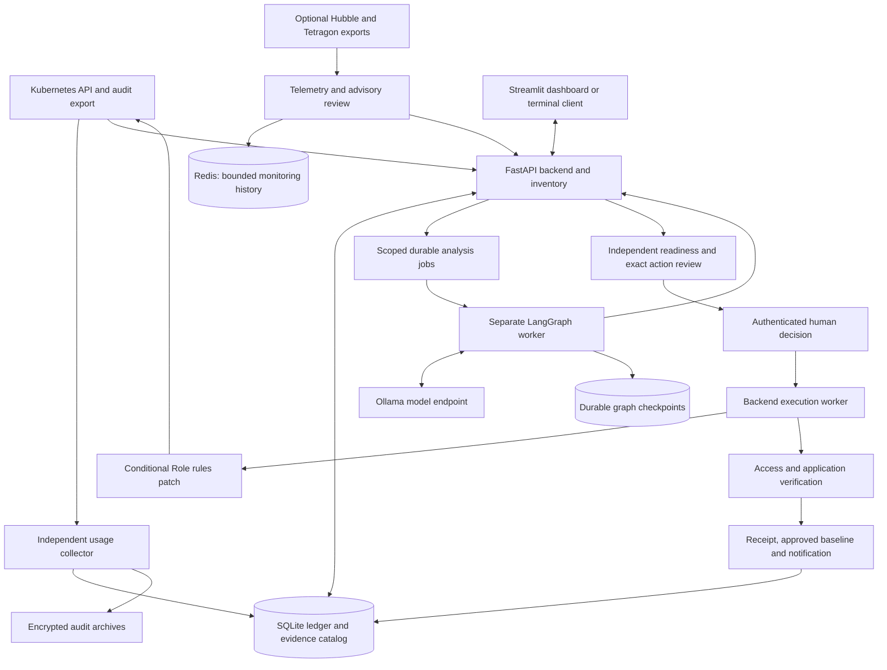

# Guardian

**Evidence-backed Kubernetes RBAC analysis with human-approved, verified permission changes.**

Guardian helps a team understand what its workloads can do, what they have actually
done, and whether a narrowly scoped permission reduction is supported by the
available evidence. It combines Kubernetes audit records, workload/RBAC inventory,
optional network and runtime telemetry, deterministic policy checks, and a local
LLM. A recommendation cannot change the cluster by itself.

The current release candidate is **0.2.0rc1**. The default laptop model is
**Qwen3.5 4B through Ollama**. The supported deployment uses one storage host with
local persistent SQLite state; it is not a distributed control plane.

## What Guardian does

- Collects identity-bound RBAC/workload inventory and exact-window API usage, with
  explicit collection coverage, source freshness and uncertainty.
- Displays pod configuration, effective permissions, audit activity, and optional
  Cilium Hubble network / Tetragon runtime observations.
- Runs bounded investigator and planner stages in a separate LangGraph worker.
  Structured outputs select existing permission IDs; deterministic code renders
  and validates the proposed rules.
- Separates saved analysis, report feedback, action preparation, human approval,
  execution and verified outcomes.
- Applies only an approved `/rules` replacement on one existing dedicated
  namespaced Role, with UID/resourceVersion conditions and unchanged bindings.
- Verifies effective access and application behavior before activating an
  approved baseline. Exact recovery requires separate, explicit consent.
- Preserves reports, decisions, receipts, notifications, evidence provenance and
  compatible restart history. Archive and coordinated backup tools are included.

**Execution is disabled by default.** Shared/unknown consumers, unsupported rules,
incomplete coverage, stale evidence, changed targets and unavailable meaningful
verification prevent supported narrowing. A high severity score is not approval.

## Architecture



The inference worker has no direct Kubernetes actuator. The deployed worker
produces previews; the backend separately prepares and executes governed actions.
Redis observations and historical approval records are not authoritative action
approval or approved desired state. See the [analysis guide](docs/analysis.md),
[governance guide](docs/governance.md) and [execution design](docs/execution.md).

## Review-to-outcome workflow

1. **Capture evidence.** Select a namespaced Role and observation window. Capture
   immutable inventory, identity, usage/coverage and any supplied workload context.
2. **Analyse.** The worker builds deterministic permission facts, investigates
   context and, when supported, proposes an exact removal. Used/protected grants
   remain retained. Missing evidence remains unknown.
3. **Read the report.** Acknowledge, reject or request context and fresh analysis.
   These report actions do not apply a Role change.
4. **Prepare the governed action.** The backend repeats independent checks,
   performs server-side admission dry-run and exercises the configured application
   harness. It publishes a separate exact action for review.
5. **Decide.** A scoped human approves the exact revision/hash and accepts residual
   risk. Recovery consent is a separate, unchecked-by-default choice. Approval
   normally allows execution to start within five minutes.
6. **Execute and verify.** The backend rechecks authority and current evidence,
   conditionally replaces the rules, then checks retained/removed access and
   application behavior. Only verified success activates the new baseline.

`DONE` means an analysis job finished; its result may still be `BLOCKED` or
`NO_CHANGE`. `readiness_incomplete` on a saved preview is separate from the later
prepared action. An approval is not a completed remediation: inspect the actual
receipt. A fresh analysis after successful narrowing can correctly say
`NO_CHANGE`.

## Run and verify

### Install the Python environment

Requires Python 3.11+ and uv. The default install does not compile llama.cpp.

```bash
uv sync --locked --extra verification
```

### Run the deterministic test suite

```bash
.venv/bin/python -m unittest discover -s tests -q
```

The most recent complete local run on 30 October 2026 passed **378 tests**.
These cover protocol, evidence, authentication, persistence, UI and execution
behavior using explicit fixtures/recording boundaries. They do not require a
live Kubernetes deployment or prove production safety.

### Run the synthetic orchestration demo

```bash
GUARDIAN_RUN=$(mktemp -d)
.venv/bin/python -m agents.guardian.demo --directory "$GUARDIAN_RUN" --skip-tests
```

This is a development/recording-backend demo: it performs no cluster writes.

### Check the real local model

With Ollama running and the default profile using its reachable local endpoint:

```bash
ollama pull qwen3.5:4b
.venv/bin/python -m scripts.guardian_model_smoke
```

The smoke checks real inference/structured output; it is not a quality benchmark.
See [model configuration](docs/models.md) for storage, profiles, limits, optional
llama.cpp/vLLM providers, and avoiding contention with advisory monitoring.

### Run the integrated laptop demo

Follow the [complete demo runbook](docs/demo-runbook.md). It has separate paths
for the prepared laptop and a clean host, including Docker/Kind, audit logging,
pinned images, Ollama connectivity, private credentials, a real workload harness,
Helm deployment, exact human review and independent outcome verification.

The prepared pilot uses:

| Item | Pilot value |
| --- | --- |
| Cluster / target namespace | `guardian-release` / `guardian-demo` |
| Private kubeconfig | `data/pilot/kubeconfig` |
| Dashboard / API forwards | `http://127.0.0.1:18501` / `http://127.0.0.1:18000` |
| Target Role / ServiceAccount | `pod-reader` |
| Model | `qwen3.5:4b`, with deployment-pinned digest |

These URLs require the documented port-forwards. Private pilot files are generated
locally and are not supplied by cloning the repository. Creating a cluster or
enabling the operator policy does not approve a remediation. The optional reverse
model relay addresses laptop routing; it still forwards to real Ollama inference.

After the API is running, the terminal can inspect the same governed reviews as
the dashboard:

```bash
.venv/bin/python -m scripts.guardian_review list
.venv/bin/python -m scripts.guardian_review --help
```

Use the [deployment guide](docs/deployment.md) for identities, storage, Helm,
backup/restore, model transport and installation on an approved lab host. The
[analysis guide](docs/analysis.md) also describes running services directly.
The old manual GGUF/Redis drift walkthrough is not the integrated demo.

## Repository layout

| Path | Responsibility |
| --- | --- |
| `agents/guardian/` | LangGraph state machine, contracts, policy/validation, model adapters, bounded tools, checkpoints and service worker |
| `agents/summarizer.py` | Advisory explanation and pod assessment helpers; no action authority |
| `backend/app/` | FastAPI routes, auth, evidence/governance ledgers, telemetry, analysis coordination and deterministic execution/recovery |
| `frontend/` | Streamlit monitoring, connections, pod evidence, analysis, report review and governed action/outcome controls |
| `contracts/` | Shared usage contract, compatibility map and architecture decision records |
| `config/` | Disabled example execution policy; actual policies remain private |
| `demo/` | Real demo reader application and functional verification harness |
| `deploy/` | Helm chart and lab deployment assets |
| `k8s/` | Audit, evidence-reader and optional observability configuration examples |
| `eval/` | Offline frozen deterministic/LLM comparison; excluded from the runtime image |
| `tests/` | Unit, contract, API, concurrency, UI and safety regression tests |
| `scripts/` | Collector, scoped credentials, pilot, model bridge, review CLI, archive, backup, capacity and release tools |
| `docs/` | Shared design, setup, operation, evaluation and release documentation |
| `pyproject.toml`, `uv.lock` | Dependency definitions and reproducible resolution |

`data/`, `.venv/`, `.env*` (except `.env.example`), `personal_docs/` and `output/`
are local/private/generated material and must stay out of Git. Reviewed example
manifests and sanitized release measurements intentionally remain versioned.

## Verification status and limits

The local Kind pilot has exercised real audit collection, Ollama analysis,
application checks and a governed Role narrowing: unused Secret read was removed,
Pod read was retained, post-change checks passed and the baseline was activated.
The latest audit also passed 39 live API checks and real dashboard revision/review
checks. This is local integration evidence, not independent university acceptance.
Hubble/Tetragon integration requires their collectors to be installed and connected;
the isolated RBAC pilot does not establish live eBPF coverage.

The offline comparison includes a retained validator-v2 development safety
failure and a conservative validator-v3 correction. No held-out pass, universal
dependency proof or LLM advantage over the deterministic baseline is claimed.
See [evaluation](docs/evaluation.md), the current
[project report](docs/project-report.md) and [release measurements](docs/release/).
Historical architecture decisions and frozen measurements retain their original
scope; the project report distinguishes those records from later live results.

Important boundaries:

- One dedicated namespaced Role and controlled consumer/workload; no general
  ClusterRole, binding or multi-object remediation.
- Finite observations and application checks cannot establish every future need.
- Unknown apply responses are not blindly retried or inferred to be success.
- Recovery restores only this action's captured rules under separate consent and
  current conditions; it is not arbitrary baseline rollback.
- SQLite/OS locks require one storage host; horizontal scaling is not supported.
- Governance/analysis/execution routes use scoped bearer credentials. Legacy
  monitoring routes require a trusted local boundary or an external authenticated
  TLS gateway; the whole API is not an internet-facing multi-tenant service.
- Separate durable backup/key custody, independent reproduction, reviewed held-out
  evaluation and university acceptance remain external delivery steps.

## Further documentation

- [Documentation index](docs/README.md)
- [Evidence, coverage and archives](docs/evidence.md)
- [Network/runtime telemetry and pod workspaces](docs/telemetry.md)
- [Authenticated governance](docs/governance.md)
- [Analysis and revisions](docs/analysis.md)
- [Execution and exact recovery](docs/execution.md)
- [Demo runbook](docs/demo-runbook.md)
- [Deployment and backup/restore](docs/deployment.md)
- [Evaluation protocol](docs/evaluation.md)
- [Attack catalog](docs/attack-catalog.md)
- [Operator/release responsibilities](docs/release-responsibilities.md)
